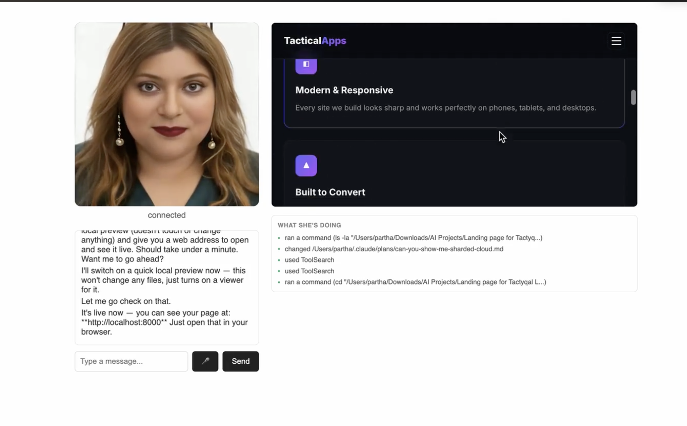

# SDE Virtual Avatar

An AI coding teammate you can video-call. You talk to her on screen, she plans and does real programming work on your computer, and keeps working after you hang up.

Built for non-developers: you manage it the way you'd manage a remote engineer. Give a task, get a plan, approve it, check back later.



*She is on the call (left), building a landing page while a live preview (top right) and an activity feed (bottom right) update as she works.*

## How it works

Two parts, deliberately kept separate:

1. **The worker** (`avatar_worker_session.py`): a persistent [Claude Code](https://claude.com/claude-code) session, driven through the Claude Agent SDK. There is one per project. It reads files, writes code and runs commands in a real folder on your machine, exactly as Claude Code does in a terminal. It runs independently of any call.
2. **The call** (`simli_bridge.py` + `simli_call.html`): a [Simli](https://www.simli.com) digital-human avatar on a local web page. It handles voice and text in, spoken replies out, a live activity feed, and an embedded preview of any site the worker starts.

Closing the browser tab doesn't stop the work.

```
 You (browser)  <-->  simli_bridge.py (local server)  <-->  Claude Code session (the worker)
      |                      |                                    reads/writes files, runs
      |                      +-- text-to-speech -> audio          commands in your project
      +-- WebRTC video/audio <-- Simli (avatar face)
```

### How it uses Claude Code

- Each project gets one long-lived Claude Code session through the Claude Agent SDK, using the same tools Claude Code has (read, edit, run commands, search).
- A system prompt on top of Claude Code's own makes it speak plain English with no developer jargon, and describe a plan with a time estimate before changing anything.
- New tasks start in Claude Code's **plan mode**. After you say yes, it switches to **accept edits** for that task, then returns to plan mode.
- A hook runs before every tool call and pauses to ask you when something looks destructive or touches `.env` or anything that looks live. It fires regardless of permission mode.
- Because it is a real Claude Code session, anything you've configured for Claude Code (a `CLAUDE.md` in the project, for example) applies to the worker in that project.

## Features

- Project picker: attach to an existing project or create a new one
- Talk or type (browser speech-to-text)
- Live plain-English activity feed
- Embedded preview of local sites the worker starts
- Plain-English replies only, no developer jargon
- Plan first: new tasks start in plan mode and wait for your go-ahead before any edits
- Access token: the page can't be used by anyone on your network without the link the server prints
- Restore points: a snapshot of the project is saved before each approved task (kept out of your normal history)
- Undo: say or type "undo that" (after a yes to confirm) to put the project back to how it was before the last task; repeat to go back further. Only covers tasks from the current server run
- Safety backstop: a deterministic hook asks for confirmation before deletions, force-pushes, database drops, or anything touching production or `.env`

## Setup

**You must bring your own accounts and API keys.** None are included, and nothing is shared with the original author. Your usage is billed to your accounts.

| What | Where to get it | `.env` setting |
|---|---|---|
| Anthropic API key (pays for the worker's thinking) | [console.anthropic.com](https://console.anthropic.com) | `ANTHROPIC_API_KEY` |
| Simli API key (the avatar's video) | [simli.com](https://www.simli.com) | `SIMLI_API_KEY` |
| A Simli face made from your own photo | Simli dashboard, then copy the face ID | `SIMLI_FACE_ID` |

You also need Python 3 and `ffmpeg` (`brew install ffmpeg` on a Mac).

```bash
git clone https://github.com/ParthaChak79/sde-virtual-avatar.git
cd sde-virtual-avatar
python3 -m venv .venv
source .venv/bin/activate
pip install -r requirements.txt
cp .env.example .env     # then open .env and paste in your three values
```

The server won't start without `SIMLI_API_KEY` and `SIMLI_FACE_ID`. If `ANTHROPIC_API_KEY` is empty, the worker falls back to whatever Claude Code is already signed in with on that computer. That is fine for personal use on your own machine. If anyone else will use it, set the key so their usage isn't charged to your login.

Never commit `.env`. It is already in `.gitignore`.

Optional settings in `.env`: `PROJECT_DIR` (the project opened by default, defaults to this folder), `AI_PROJECTS_DIR` (where new projects are created, defaults to `~/AI Projects`), and `ACCESS_TOKEN` (keeps the call link the same between restarts).

## Run

```bash
python3 -u simli_bridge.py     # start the call server
# then open the link it prints (http://localhost:8765/?token=...)
```

Click **Join Call**, pick a project, and tell it what you want. It will describe a plan; say "yes" to let it start.

To talk to the worker in a plain terminal without the avatar: `python3 test_worker.py`

To run the tests: `pip install pytest && python3 -m pytest`

## Status

Working: video call with a custom avatar face, voice input, multiple projects, activity feed, live preview, restore points and undo.

Not started: cloned voice (currently edge-tts) and outbound "employee calls you" notifications.

The call is reachable on your own network only, and only with the access token. See [CLAUDE.md](CLAUDE.md) for architecture details and design decisions.
